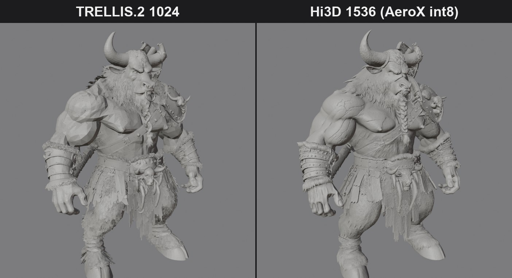
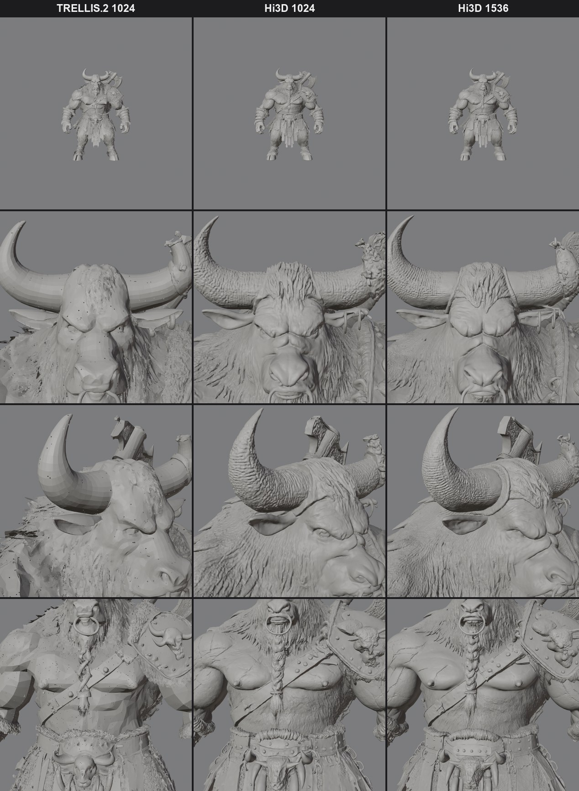
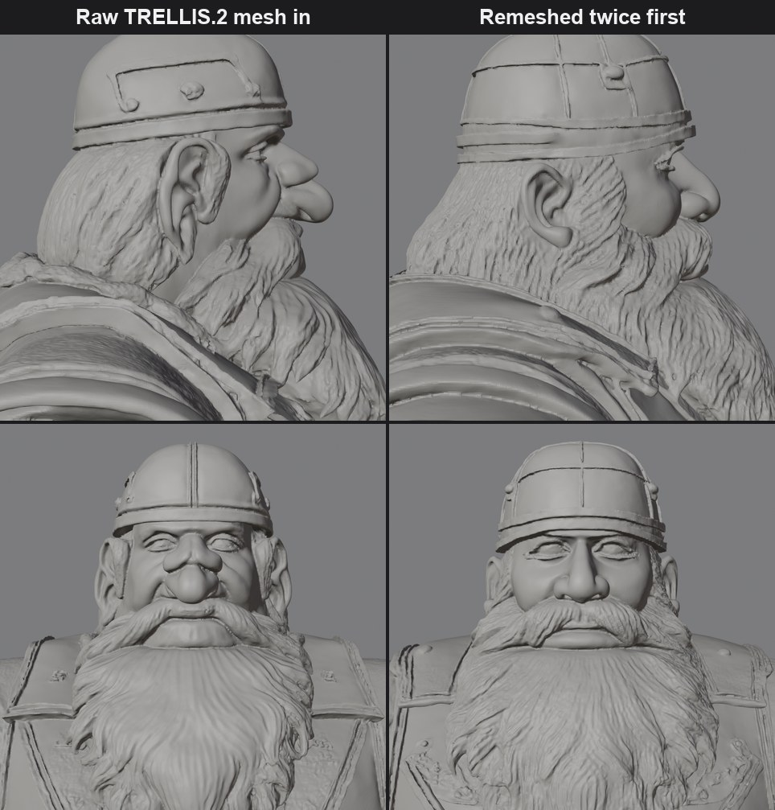

# Hi3D for ComfyUI - Detailed 3D Meshes on 6 GB GPUs

Turns **one image** into a **highly detailed 3D model** at 512, 1024 or 1536 (or refines a rough mesh you already have): hair strands, rivets, wrinkles, scales. Free and local in ComfyUI, with native nodes and 6 GB weights by **[AeroX](https://github.com/Aero-Ex/Aero-Ex-ComfyUI-Hi3D)** and a one-click installer for Windows.



Workflow 01 does it all in one go: upload an image, TRELLIS.2 or Pixal3D (one switch) builds the coarse model, Hi3D adds the detail. Tested on characters (a dwarf, a minotaur) and a detailed dragon statue. Workflow 04 goes on to a textured low-poly game character.

## Which workflow?

| Workflow | What it does | RTX 5080 (16 GB) |
|---|---|---|
| **01 Image to Hi3D** | upload an image > TRELLIS.2 or Pixal3D (switch) > Hi3D 512 > 1024 > 1536; saves the coarse mesh and all three. **Start here.** | 11-14 min (character, first run incl. model loading) |
| **02 Your Mesh, Refine Chain** | your own coarse mesh + its image > Hi3D 512 > 1024 > 1536 | 4-6 min (character), ~15 min (detailed statue) |
| **03 Your Mesh, Single Pass** | one pass at the resolution you pick (512 / 1024 / 1536) | 1024: ~1.5 min |
| **04 Image to Low-Poly Game Character** | upload an image > TRELLIS.2 1024 > Hi3D 512 > 1024 > 12k low-poly with a baked normal map > UltraTex textures. Needs a second pack, see [Workflow 04](#workflow-04-image-to-a-textured-game-character). | ~18 min (character) |

All four clean the coarse mesh first with **two Remesh passes** (AeroX's tip, see [Tips](#tips)).

## Install

### a) Recommended: ComfyUI-Easy-Install

1. Install [ComfyUI-Easy-Install](https://github.com/Tavris1/ComfyUI-Easy-Install) if you don't have it yet. My **[installation guide](https://go.pixel-artistry.com/Trellis2InstallationGuide)** walks you through every step.
2. On this page: **Code → Download ZIP**.
3. Unzip it into `ComfyUI-Easy-Install\Add-Ons\`. You get `Add-Ons\PixelArtistry-Hi3D-main\` with `Install-Hi3D.bat` inside. (The workflows are built into the installer, so the `.bat` on its own directly in `Add-Ons` works too.)
4. Close ComfyUI.
5. Double-click `Install-Hi3D.bat`.

### b) Other ComfyUI portable installs

Put the unzipped folder next to `python_embeded` and run `Install-Hi3D.bat` there.

### What the installer does

- Checks your ComfyUI version. Hi3D needs **ComfyUI v0.42.0 or newer**; on an older one it stops and tells you how to update.
- Installs [AeroX's Hi3D nodes](https://github.com/Aero-Ex/Aero-Ex-ComfyUI-Hi3D) at the tested, pinned version `227d18f`. No extra Python packages: the nodes only use ComfyUI itself, so your Python environment stays untouched.
- Asks for **int8** (4.3 GB, recommended) or **fp16** (7.7 GB) weights, or both, and shows your GPU's VRAM.
- Asks whether to install the **image-to-3D models** for workflows 01 and 04: TRELLIS.2, Pixal3D, their shape VAE, DINOv3 and MoGe (about 13.8 GB). Already installed from my other packs? They're found and skipped.
- Scans `ComfyUI\models` **and** `extra_model_paths.yaml`, so linked model folders (e.g. from Easy-Models-Linker) count.
- Lists the missing models and **asks** before downloading anything. Every download is checked with SHA-256.
- Puts my 4 workflows (built into the installer) into `ComfyUI\user\default\workflows\PixelArtistry\Hi3D`, so they show up in the workflow sidebar under **PixelArtistry > Hi3D**. If you only have the fp16 weights, the workflows are switched to them. On a re-run, a workflow that differs from the current one is replaced, and your old file is kept next to it as `.bak`.
- Checks the extra nodes of **workflow 04**. It needs nodes from my Animated-Characters pack, which this installer doesn't install. The workflow is added either way, and the installer lists the missing nodes at the end, see [Workflow 04](#workflow-04-image-to-a-textured-game-character).
- Safe to re-run: existing files are skipped, unfinished downloads resume.

**Requirements:** Windows, NVIDIA GPU with 6 GB+, ComfyUI v0.42.0+ (tested on v0.45.4), ~8 GB disk with int8 (~11 GB with fp16), plus ~14 GB for the image-to-3D models of workflows 01 and 04, 16 GB RAM (ComfyUI peaked at 5.5 GB in my 6 GB test).

### c) Manual install

**1. Nodes** - open a terminal in `ComfyUI\custom_nodes`:

```bash
git clone https://github.com/Aero-Ex/Aero-Ex-ComfyUI-Hi3D
cd Aero-Ex-ComfyUI-Hi3D
git checkout 227d18f
```

This is the tested version. Newer versions may work, but I haven't tested them.

**2. Models** - from [Aero-Ex/ComfyUI-Hi3D](https://huggingface.co/Aero-Ex/ComfyUI-Hi3D):

| File | Folder | Size |
|---|---|---|
| `hi3d_v1_int8.safetensors` (6 GB+) **or** `hi3d_v1.safetensors` (fp16) | `models/checkpoints` | 4.3 / 7.7 GB |
| `dinov2-large.safetensors` | `models/clip_vision` | 1.2 GB |
| `clip-vit-large-patch14.safetensors` | `models/clip_vision` | 1.7 GB |
| `birefnet.safetensors` | `models/background_removal` | 0.4 GB, from [Comfy-Org/BiRefNet](https://huggingface.co/Comfy-Org/BiRefNet/resolve/main/background_removal/birefnet.safetensors) |

For workflows 01 and 04 (image to 3D), also:

| File | Folder | Size |
|---|---|---|
| `trellis_2_int8_convrot.safetensors` | `models/diffusion_models` | 5.3 GB, [Comfy-Org/TRELLIS.2](https://huggingface.co/Comfy-Org/TRELLIS.2/resolve/main/diffusion_models/trellis_2_int8_convrot.safetensors) |
| `pixal3d_int8_convrot.safetensors` | `models/diffusion_models` | 5.6 GB, [Comfy-Org/Pixal3D](https://huggingface.co/Comfy-Org/Pixal3D/resolve/main/diffusion_models/pixal3d_int8_convrot.safetensors) |
| `trellis_2_shape_vae_bf16.safetensors` | `models/vae` | 1.1 GB, [Comfy-Org/TRELLIS.2](https://huggingface.co/Comfy-Org/TRELLIS.2/resolve/main/vae/trellis_2_shape_vae_bf16.safetensors) |
| `dino_v3_L_naf_fp32.safetensors` | `models/clip_vision` | 1.2 GB, [Comfy-Org/Pixal3D](https://huggingface.co/Comfy-Org/Pixal3D/resolve/main/clip_vision/dino_v3_L_naf_fp32.safetensors) |
| `moge_2_vitl_normal_fp16.safetensors` | `models/geometry_estimation` | 0.7 GB, [Comfy-Org/MoGe](https://huggingface.co/Comfy-Org/MoGe/resolve/main/geometry_estimation/moge_2_vitl_normal_fp16.safetensors) |

ComfyUI checks every model in the graph before a run, so workflows 01 and 04 need both TRELLIS.2 and Pixal3D even if you only use one.

**3. Workflows** - drag the JSONs from the `workflows` folder onto the ComfyUI canvas, or copy them into `ComfyUI\user\default\workflows\PixelArtistry\Hi3D` (create the folders) to see them in the sidebar under **PixelArtistry > Hi3D**.

**4. Restart ComfyUI.**

## Results

**Minotaur**, one image > TRELLIS.2 1024 > Hi3D, made on a 6 GB VRAM budget (TRELLIS.2 1:45 min, Hi3D 13:00 min). Left to right: TRELLIS.2, Hi3D 1024, Hi3D 1536. The TRELLIS.2 mesh has 182,613 holes; all three Hi3D versions have 0 open holes.



More: [dwarf and dragon](docs/images/hero.jpg).

## How to use

1. Open **PixelArtistry_Hi3D_01_Image_to_Hi3D**.
2. **1 · Upload your image:** one object or character, square works best, any background (BiRefNet cuts it out).
3. **3 · Pick the model:** `true` = TRELLIS.2 (default), `false` = Pixal3D.
4. Queue. The meshes land in `ComfyUI\output\hi3d\`: `coarse` (before Hi3D), `refined_512`, `refined_1024`, `refined_1536`.

Already have a mesh? Use **workflow 02**: load your mesh in *Load Coarse Mesh* and the image it was made from in *Reference Image*.

## Workflow 04: image to a textured game character

The full pipeline from the video, in one run: image > TRELLIS.2 (1024) > Hi3D 512 > 1024 > a 12,000-triangle low-poly > normal map baked from the Hi3D mesh > UltraTex colour and metal/roughness > one GLB.

`Install-Hi3D.bat` puts it into the sidebar with the other three. It also needs nodes and models that this installer doesn't bring; if they are missing, the installer lists them at the end.

1. Run `Install-Hi3D.bat` from this page.
2. Install my **[Animated-Characters pack](https://github.com/pixelartistry/PixelArtistry-Animated-Characters)**. Its installer brings MostAadTech's LODTailor, Bake Forger, Fast Merge, Memory Cleaner and UltraTex nodes, ComfyUI-GGUF and the UltraTex models, and it finds Blender. The TRELLIS.2 and Pixal3D models can come from either installer.
3. Open **PixelArtistry_Hi3D_04_Image_to_LowPoly_TRELLIS2_Hi3D_UltraTex**, load your image, set the **Blender path** node once (forward slashes, e.g. `D:/Blender/blender.exe`), then Run.

If the Animated-Characters workflows were already installed when you ran `Install-Hi3D.bat`, the Blender path is copied from them. A path you set in workflow 04 yourself is kept when you run the installer again.

The results land in `ComfyUI\output\3d\`: `PixelArtistry_hi3d_final` (the textured game character), `PixelArtistry_hi3d_lowpoly` (before UltraTex) and `PixelArtistry_hi3d_detail_1024` (the Hi3D mesh).

- **Measured on my RTX 5080 (16 GB), minotaur:** about 18 min for the whole run, final model 11,943 triangles. Whole-card VRAM peaked at 13.1 GB in the Hi3D step and 16.0 GB in the UltraTex step.
- **Close your browser and other heavy apps first.** My 48 GB of system RAM was full during the UltraTex step, with other apps using about 26 GB of it.
- **Not tested on a 6 GB budget.** The 6 GB test below covers TRELLIS.2 and Hi3D, not the low-poly and UltraTex steps.
- **No 1536 pass and no watertight step:** a 2K normal map can't hold more detail than the 1024 mesh, and LODTailor rebuilds the low-poly anyway. The low-poly had no visible holes in my test but is not strictly closed (87 open edges); for 3D printing, run a watertight step on the saved Hi3D mesh.
- **License:** UltraTex runs on FLUX.2 Klein base 9B, which is licensed for non-commercial use. See [License](#license).

## 6 GB test

I made my RTX 5080 behave like a 6 GB card: a second process held all VRAM except **6.0 GB free** (measured with NVML, like nvidia-smi). Then I ran the Hi3D chain (workflow 02: remesh twice, 512 > 1024 > 1536) on the dwarf, in a fresh ComfyUI installed with this installer.

| Weights | 6 GB free | Full 16 GB card |
|---|---|---|
| int8 | **6:10 min**, finishes | 5:31 min |
| fp16 | **6:00 min**, finishes | 3:53 min |

- ComfyUI used at most **6.2 GB** of VRAM (everything it had) and its shared GPU memory stayed at 0.28 GB, the same as without the limit. So nothing spilled into system RAM; ComfyUI's dynamic VRAM streamed the weights instead.
- ComfyUI itself peaked at **5.5 GB RAM**.
- **Image to 3D on a 6 GB budget** (the path of workflow 01): the minotaur went through TRELLIS.2 (1:45 min) and the full Hi3D chain (13:00 min) on my normal ComfyUI with 6 GB left free. ComfyUI peaked at 6.4 GB, because other apps freed some VRAM during the run; on the full card the same Hi3D chain took 13:49 min.
- Same quality level as on the full card. Small details such as the helmet straps change from run to run.
- **Reported by AeroX** (not measured by me): RTX 4050 laptop 6 GB, 512 > 1024 > 1536 in 326 s with int8 and 517 s with fp16; the 1536 decode peaks around 5 GB. On his card int8 is the faster one, so int8 stays my recommendation for 6-8 GB.

## Tips

- **Remesh twice (AeroX's fix).** All three workflows run *Remesh Mesh* (`solid`, fill 20, 1024) two times before Hi3D. Without it, the stair-steps and broken thin parts of a TRELLIS.2 mesh carry over: on my dwarf the ear grew a lumpy flap and the nose bulged. With it, ear and face come out clean.

  

  It depends on the mesh, though: on my minotaur, whose TRELLIS.2 mesh was already clean, the run without remesh kept a bit more detail in the face and a cleaner horn cap. If your model loses detail, select the two Remesh nodes, bypass them (Ctrl+B) and compare.
- **Reference image:** the image the mesh was made from, ideally square. Hi3D follows the image for the fine detail, so a sharp image gives sharper detail.
- **Seed:** small details (rivets, the facial expression) change from seed to seed. If a face comes out off, try another seed on the sampler.
- **Big meshes:** the 1536 result has ~8-12 million faces (150-260 MB). For games or texturing, add a *Decimate Mesh* node (e.g. 1M faces) before saving.
- **Not watertight:** the results have **0 open holes**, but a few hundred edges where thin parts touch and some tiny loose bits. For 3D printing, run a watertight step afterwards, e.g. my [Image-to-3D-Print](https://github.com/pixelartistry/PixelArtistry-Image-to-3D-Print) or [Watertight-Meshes](https://github.com/pixelartistry/PixelArtistry-Watertight-Meshes) workflows.
- **int8 or fp16?** Same quality in my tests. int8 is the smaller download and the 6 GB choice; on a 16 GB card fp16 was a bit faster.

## Troubleshooting

| You see | Fix |
|---|---|
| Workflow 04: red nodes, 12 unknown `UTX…` nodes ("Unknown pack"), or `invalid prompt: Node 'ID #353' has no class_type` | MostAadTech's low-VRAM UltraTex nodes are not installed. Close ComfyUI, run the [Animated-Characters installer](https://github.com/pixelartistry/PixelArtistry-Animated-Characters), start ComfyUI again. ComfyUI Manager can't install this pack, and the standard UltraTex install is not enough: it brings visualbruno's nodes, workflow 04 uses MostAadTech's. |
| Workflow 04: the `UTX…` nodes are there, but a node reports a value that is "not in list" | Your UltraTex nodes are probably a different version. Workflow 04 is tested with the version the Animated-Characters installer pins (`4dea3ff`); run that installer to switch to it. If `custom_nodes\comfyui_ultratex_modular` was installed without git, delete that folder first. |
| Workflow 04: other red nodes (LODTailor, Bake Forger, Fast Merge, Memory Cleaner, GGUF loaders) | Same fix: the Animated-Characters installer brings all of them. `Install-Hi3D.bat` lists what is missing at the end of its run. |
| LODTailor / Bake Forger: `WinError 2` | The Blender path is wrong or uses single backslashes. Set the **Blender path** node with forward slashes, e.g. `D:/Blender/blender.exe`. |

## Credits & links

- **[AeroX](https://github.com/Aero-Ex)**: the native ComfyUI Hi3D nodes ([Aero-Ex-ComfyUI-Hi3D](https://github.com/Aero-Ex/Aero-Ex-ComfyUI-Hi3D)), the int8 / fp16 weights ([Aero-Ex/ComfyUI-Hi3D](https://huggingface.co/Aero-Ex/ComfyUI-Hi3D)) and the example workflows mine are based on. Thanks for building the 6 GB version!
- [Hi3D v1.0](https://github.com/hi3d-official/Hi3Dv1.0) (SPARC3D) by OCEANO HK HOLDING LIMITED
- TRELLIS.2 by Microsoft, Pixal3D by Tsinghua University and Tencent ARC, MoGe by Microsoft, DINOv2 and DINOv3 by Meta, CLIP by OpenAI, [BiRefNet](https://huggingface.co/Comfy-Org/BiRefNet); the ComfyUI versions of these models by Comfy-Org
- **[MostAadTech](https://github.com/Mstafa-awad)**: LODTailor, Bake Forger, Fast Merge, Memory Cleaner and the low-VRAM UltraTex nodes used by workflow 04. [UltraTex](https://yiboz2001.github.io/UltraTex/) (SIGGRAPH Asia 2026), FLUX.2 Klein by Black Forest Labs, [ComfyUI-GGUF](https://github.com/city96/ComfyUI-GGUF) by city96
- [ComfyUI-Easy-Install](https://github.com/Tavris1/ComfyUI-Easy-Install) by Tavris1 / ivo (Pixaroma Community Edition)

**PixelArtistry:**

- YouTube: [youtube.com/@PixelArtistry_](https://www.youtube.com/@PixelArtistry_)
- FutureFrames newsletter: [go.pixel-artistry.com/newsletter](https://go.pixel-artistry.com/newsletter)
- Workflow Pack waitlist: [go.pixel-artistry.com/Trellis2WorkflowPackWaitlist](https://go.pixel-artistry.com/Trellis2WorkflowPackWaitlist)

## License

> [!IMPORTANT]
> - **My files in this repo** (installer, workflow changes and notes, comparison images): [MIT](LICENSE).
> - **AeroX's nodes, the Hi3D weights and the Hi3D model** are under the **Hi3D Open License Agreement v1.0** (OCEANO HK HOLDING LIMITED), including its Acceptable Use Policy. The full text is in the `LICENSE` file of AeroX's node folder.
> - **Commercial use is allowed.** Your meshes are yours: the licensor claims no ownership of outputs, and you can sell, edit and share them without any notice.
> - **Only products or services that build Hi3D itself in** must show "Powered by Hi3D 1.0", and need a separate license above 200,000 monthly users or USD 1M monthly revenue.
> - **TRELLIS.2, Pixal3D, MoGe, DINOv3** and the other models used by workflows 01 and 04 keep their own licenses (DINOv3: DINOv3 License by Meta).
> - **Workflow 04 is different:** its UltraTex step runs on **FLUX.2 Klein base 9B**, which is under the **FLUX Non-Commercial License v2.1** by Black Forest Labs. The "commercial use is allowed" line above is about Hi3D only. Details in the [Animated-Characters license notes](https://github.com/pixelartistry/PixelArtistry-Animated-Characters#license).
> - This is not legal advice.
