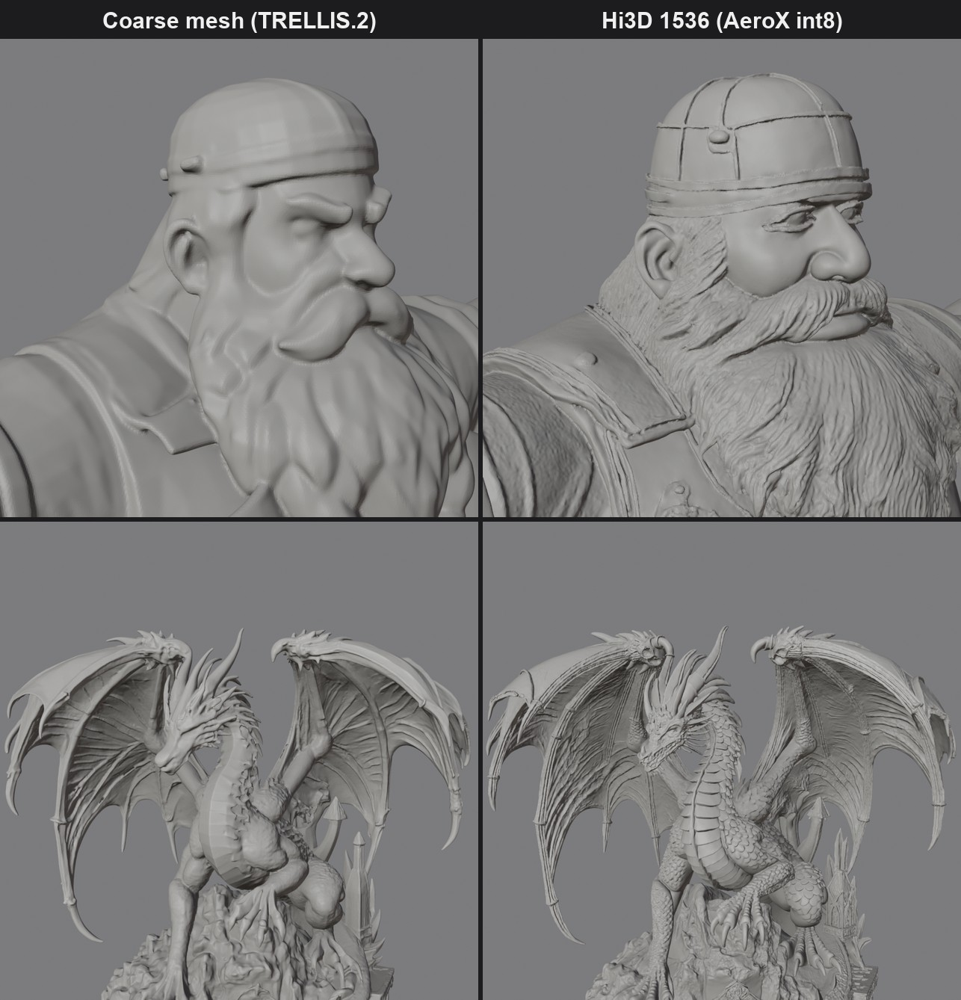
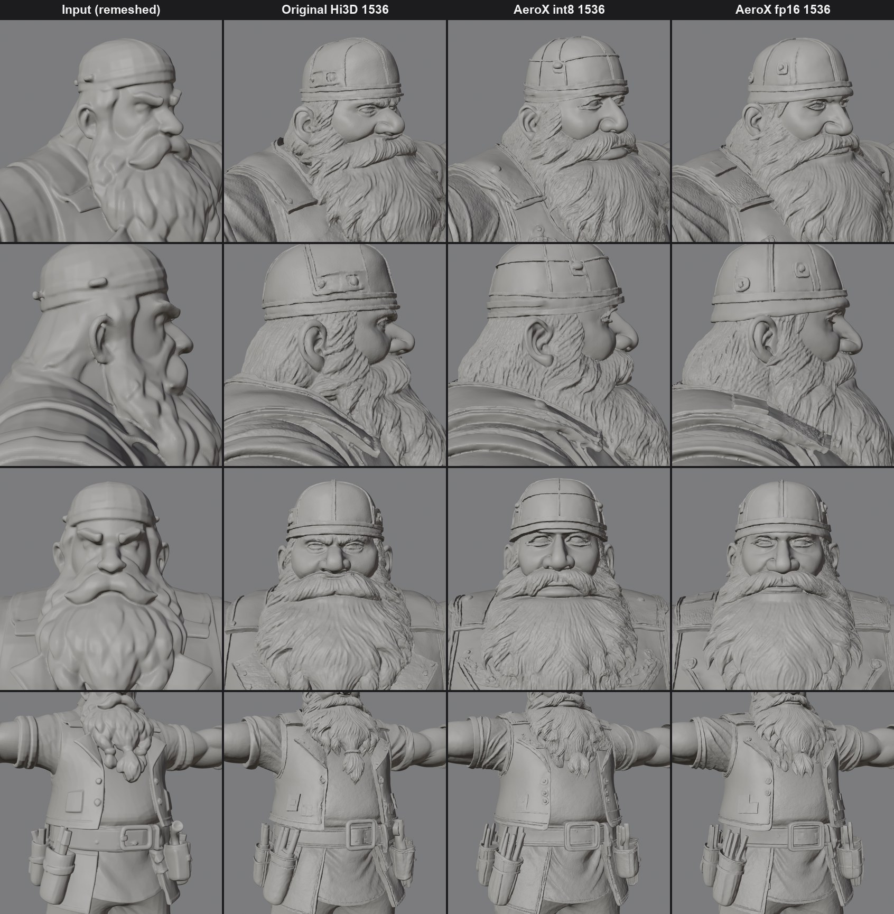
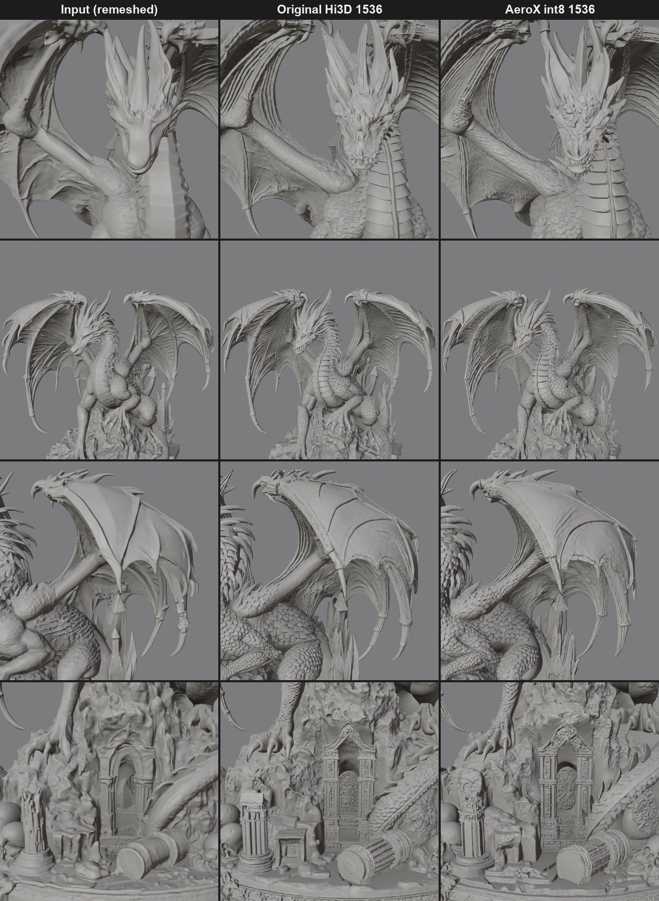

# Hi3D for ComfyUI - Detailed 3D Meshes on 6 GB GPUs

Turns a rough 3D mesh plus its reference image into a **highly detailed mesh** at 512, 1024 or 1536: hair strands, rivets, wrinkles, scales. Free and local in ComfyUI, with native nodes and 6 GB weights by **[AeroX](https://github.com/Aero-Ex/Aero-Ex-ComfyUI-Hi3D)** and a one-click installer for Windows.



Tested with TRELLIS.2 meshes (a dwarf character and a detailed dragon statue). Other coarse meshes work the same way: Pixal3D, Hunyuan3D or your own sculpt.

## Which workflow?

| Workflow | What it does | RTX 5080 (16 GB) |
|---|---|---|
| **01 Refine Chain 512 > 1024 > 1536** | three passes, each refines the mesh of the one before; saves all three. **Start here.** | 4-6 min (character), ~15 min (detailed statue) |
| **02 Refine Single Pass** | one pass at the resolution you pick (512 / 1024 / 1536) | 1024: ~1.5 min |

Both clean the coarse mesh first with **two Remesh passes** (AeroX's tip, see [Tips](#tips)).

## Install

### a) Recommended: ComfyUI-Easy-Install

1. Install [ComfyUI-Easy-Install](https://github.com/Tavris1/ComfyUI-Easy-Install) if you don't have it yet. My **[installation guide](https://go.pixel-artistry.com/Trellis2InstallationGuide)** walks you through every step.
2. On this page: **Code → Download ZIP**.
3. Unzip it into `ComfyUI-Easy-Install\Add-Ons\`. You get `Add-Ons\PixelArtistry-Hi3D-main\` with `Install-Hi3D.bat` inside. (The workflows are built into the installer, so the `.bat` on its own directly in `Add-Ons` works too.)
4. Close ComfyUI.
5. Double-click `Install-Hi3D.bat`.

### b) Other ComfyUI portable installs

Put the unzipped folder next to `python_embeded` and run `Install-Hi3D.bat` there.

### What the installer does

- Checks your ComfyUI version. Hi3D needs **ComfyUI v0.42.0 or newer**; on an older one it stops and tells you how to update.
- Installs [AeroX's Hi3D nodes](https://github.com/Aero-Ex/Aero-Ex-ComfyUI-Hi3D) at the tested, pinned version `227d18f`. No extra Python packages: the nodes only use ComfyUI itself, so your Python environment stays untouched.
- Asks for **int8** (4.3 GB, recommended) or **fp16** (7.7 GB) weights, or both, and shows your GPU's VRAM.
- Scans `ComfyUI\models` **and** `extra_model_paths.yaml`, so linked model folders (e.g. from Easy-Models-Linker) count.
- Lists the missing models and **asks** before downloading anything. Every download is checked with SHA-256.
- Puts my 2 workflows (built into the installer) into `ComfyUI\user\default\workflows\PixelArtistry`, so they show up in the workflow sidebar in the **PixelArtistry** folder. If you only have the fp16 weights, the workflows are switched to them. On a re-run, a workflow that differs from the current one is replaced, and your old file is kept next to it as `.bak`.
- Safe to re-run: existing files are skipped, unfinished downloads resume.

**Requirements:** Windows, NVIDIA GPU with 6 GB+, ComfyUI v0.42.0+ (tested on v0.45.4), ~8 GB disk with int8 (~11 GB with fp16), 16 GB RAM (ComfyUI peaked at 5.5 GB in my 6 GB test).

### c) Manual install

**1. Nodes** - open a terminal in `ComfyUI\custom_nodes`:

```bash
git clone https://github.com/Aero-Ex/Aero-Ex-ComfyUI-Hi3D
cd Aero-Ex-ComfyUI-Hi3D
git checkout 227d18f
```

This is the tested version. Newer versions may work, but I haven't tested them.

**2. Models** - from [Aero-Ex/ComfyUI-Hi3D](https://huggingface.co/Aero-Ex/ComfyUI-Hi3D):

| File | Folder | Size |
|---|---|---|
| `hi3d_v1_int8.safetensors` (6 GB+) **or** `hi3d_v1.safetensors` (fp16) | `models/checkpoints` | 4.3 / 7.7 GB |
| `dinov2-large.safetensors` | `models/clip_vision` | 1.2 GB |
| `clip-vit-large-patch14.safetensors` | `models/clip_vision` | 1.7 GB |
| `birefnet.safetensors` | `models/background_removal` | 0.4 GB, from [Comfy-Org/BiRefNet](https://huggingface.co/Comfy-Org/BiRefNet/resolve/main/background_removal/birefnet.safetensors) |

**3. Workflows** - drag the JSONs from the `workflows` folder onto the ComfyUI canvas, or copy them into `ComfyUI\user\default\workflows\PixelArtistry` (create the folder) to see them in the sidebar's **PixelArtistry** folder.

**4. Restart ComfyUI.**

## How to use

1. Open **PixelArtistry_Hi3D_01_Refine_Chain_512-1024-1536**.
2. **Load Coarse Mesh:** upload your mesh (GLB, OBJ, PLY...).
3. **Reference Image:** the image the mesh was made from. Any background works, BiRefNet cuts it out.
4. Queue. The meshes land in `ComfyUI\output\hi3d\` (`refined_512`, `refined_1024`, `refined_1536`).

## AeroX vs the original Hi3D pipeline

Same coarse mesh (remeshed twice), same reference image, seed 42, 25 steps, both at their default settings. The original pipeline is [thatname/ComfyUI-Hi3D](https://github.com/thatname/ComfyUI-Hi3D), which runs the official Hi3D release code; AeroX rebuilt Hi3D on ComfyUI's own sampler and memory management.

**Dwarf, 1536**



**Dragon, 1536**



1024 versions: [dwarf](docs/images/compare_dwarf_1024.jpg) · [dragon](docs/images/compare_dragon_1024.jpg)

| | Original pipeline | AeroX (int8) |
|---|---|---|
| Detail (hair, scales, ornaments) | high | **same level** |
| Open holes (dwarf / dragon, 1536) | 43 / 90 | **0 / 0** |
| Edges where thin parts touch (dwarf / dragon, 1536) | **84 / 118** | 743 / 2,565 |
| Tiny loose pieces (dwarf / dragon, 1536) | **46 / 39** | 571 / 1,939 (99.98 % of the mesh is one piece) |
| VRAM | used ~5.3 GB (1024) / ~8.1 GB (1536) on my 16 GB card; not tested on 6 GB | **runs at 1536 with 6 GB free, verified** ([below](#6-gb-test)) |
| Install | extra CUDA packages (spconv, flash-attn, CUDA toolkit) | **nothing extra**, native ComfyUI |
| First run | ~4 min loading the model on the CPU | starts right away |
| Failed runs in my tests | 3 of 14 (random, works when queued again) | 0 of 7 |

My take: **the detail is the same.** AeroX's version closes every hole and runs on 6 GB without installing anything; the original leaves pinholes but fewer stray edges and loose bits. On the dwarf, the original kept the angry expression closer to the image in this run, while AeroX relaxed it. In my earlier tests the original relaxed the same face too, so the expression varies from seed to seed in both. On the dragon both are very close.

## 6 GB test

I made my RTX 5080 behave like a 6 GB card: a second process held all VRAM except **6.0 GB free** (measured with NVML, like nvidia-smi). Then I ran workflow 01 (remesh twice, 512 > 1024 > 1536) on the dwarf, in a fresh ComfyUI installed with this installer.

| Weights | 6 GB free | Full 16 GB card |
|---|---|---|
| int8 | **6:10 min**, finishes | 5:31 min |
| fp16 | **6:00 min**, finishes | 3:53 min |

- ComfyUI used at most **6.2 GB** of VRAM (everything it had) and its shared GPU memory stayed at 0.28 GB, the same as without the limit. So nothing spilled into system RAM; ComfyUI's dynamic VRAM streamed the weights instead.
- ComfyUI itself peaked at **5.5 GB RAM**.
- Same quality level as on the full card. Small details such as the helmet straps change from run to run.
- **Reported by AeroX** (not measured by me): RTX 4050 laptop 6 GB, 512 > 1024 > 1536 in 326 s with int8 and 517 s with fp16; the 1536 decode peaks around 5 GB. On his card int8 is the faster one, so int8 stays my recommendation for 6-8 GB.

## Tips

- **Remesh twice (AeroX's fix).** Both workflows run *Remesh Mesh* (`solid`, fill 20, 1024) two times before Hi3D. Without it, the stair-steps and broken thin parts of a TRELLIS.2 mesh carry over: on my dwarf the ear grew a lumpy flap and the nose bulged. With it, ear and face come out clean.

  
- **Reference image:** the image the mesh was made from, ideally square. Hi3D follows the image for the fine detail, so a sharp image gives sharper detail.
- **Seed:** small details (rivets, the facial expression) change from seed to seed. If a face comes out off, try another seed on the sampler.
- **Big meshes:** the 1536 result has ~8-12 million faces (150-260 MB). For games or texturing, add a *Decimate Mesh* node (e.g. 1M faces) before saving.
- **Not watertight:** the results have **0 open holes**, but a few hundred edges where thin parts touch and some tiny loose bits. For 3D printing, run a watertight step afterwards, e.g. my [Image-to-3D-Print](https://github.com/pixelartistry/PixelArtistry-Image-to-3D-Print) or [Watertight-Meshes](https://github.com/pixelartistry/PixelArtistry-Watertight-Meshes) workflows.
- **int8 or fp16?** Same quality in my tests. int8 is the smaller download and the 6 GB choice; on a 16 GB card fp16 was a bit faster.

## Credits & links

- **[AeroX](https://github.com/Aero-Ex)**: the native ComfyUI Hi3D nodes ([Aero-Ex-ComfyUI-Hi3D](https://github.com/Aero-Ex/Aero-Ex-ComfyUI-Hi3D)), the int8 / fp16 weights ([Aero-Ex/ComfyUI-Hi3D](https://huggingface.co/Aero-Ex/ComfyUI-Hi3D)) and the example workflows mine are based on. Thanks for building the 6 GB version!
- [Hi3D v1.0](https://github.com/hi3d-official/Hi3Dv1.0) (SPARC3D) by OCEANO HK HOLDING LIMITED
- [thatname/ComfyUI-Hi3D](https://github.com/thatname/ComfyUI-Hi3D): the original-pipeline node pack used in the comparison
- [BiRefNet](https://huggingface.co/Comfy-Org/BiRefNet) by Comfy-Org, DINOv2 by Meta, CLIP by OpenAI
- [ComfyUI-Easy-Install](https://github.com/Tavris1/ComfyUI-Easy-Install) by Tavris1 / ivo (Pixaroma Community Edition)

**PixelArtistry:**

- YouTube: [youtube.com/@PixelArtistry_](https://www.youtube.com/@PixelArtistry_)
- FutureFrames newsletter: [go.pixel-artistry.com/newsletter](https://go.pixel-artistry.com/newsletter)
- Workflow Pack waitlist: [go.pixel-artistry.com/Trellis2WorkflowPackWaitlist](https://go.pixel-artistry.com/Trellis2WorkflowPackWaitlist)

## License

> [!IMPORTANT]
> - **My files in this repo** (installer, workflow changes and notes, comparison images): [MIT](LICENSE).
> - **AeroX's nodes, the Hi3D weights and the Hi3D model** are under the **Hi3D Open License Agreement v1.0** (OCEANO HK HOLDING LIMITED), including its Acceptable Use Policy. The full text is in the `LICENSE` file of AeroX's node folder.
> - **Commercial use is allowed.** Your meshes are yours: the licensor claims no ownership of outputs, and you can sell, edit and share them without any notice.
> - **Only products or services that build Hi3D itself in** must show "Powered by Hi3D 1.0", and need a separate license above 200,000 monthly users or USD 1M monthly revenue.
> - This is not legal advice.
